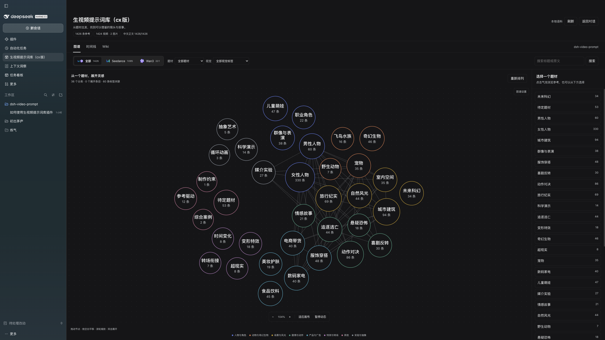
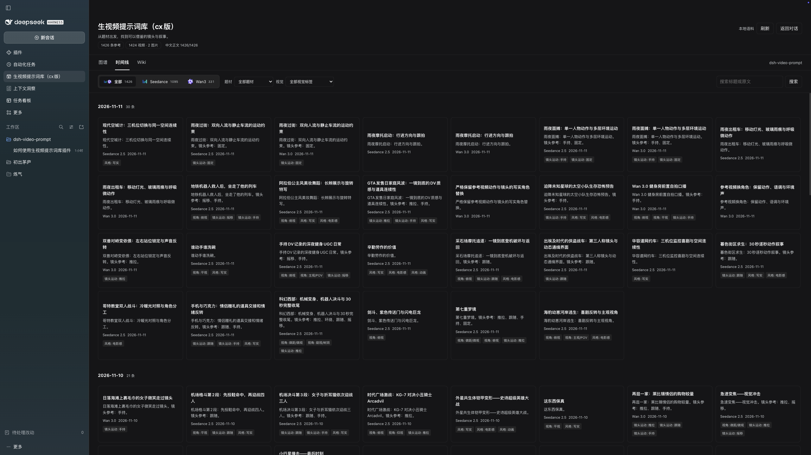
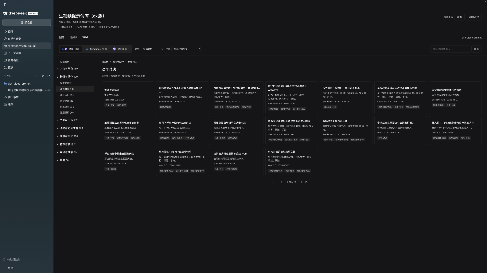

# 生视频提示词库

主要整理 X 上高质量的 **Seedance 2.5 和 Wan3 中文提示词**，把分散的参考变成可以浏览、检索、复制和追溯来源的 DeepSeek Harness 插件。

📌 **库里的提示词会持续更新。**

自己逛着找灵感，或者直接让 AI 帮忙查，都可以。



## 顺着题材找灵感

在图谱里拖动、缩放、展开分类，顺着不同题材寻找参考。可以按模型、题材和视觉标签筛选，把关注点放到人物动作、镜头运动、画面风格或具体场景上。

- 拖动节点，观察分类之间的联系；拖动空白处平移，滚轮缩放。
- 点击分类浏览参考，双击展开提示词节点。
- 找到合适的内容后，直接复制中文提示词，也能对照原文、查看作者和来源。

## 用时间线和 Wiki 浏览

时间线按来源日期排列参考，方便回顾近期整理的内容；没有日期的条目单独归组。Wiki 则按题材逐层展开，适合带着一个方向慢慢找。

### 时间线



### Wiki 题材目录



*以上是完整库的功能演示截图，来自较早界面版本。当前插件名为「生视频提示词库」；可用语料以实际安装版本为准，公开发行范围见文末。*

## 也可以直接和 AI 对话

安装并启用插件后，可以在 DSH 对话里带着具体需求调用这个库。例如：

> 我想用 Seedance 2.5 做一段 30 秒的武侠打斗，帮我找几个参考，看看动作和运镜怎么写，再整理一版中文提示词。

> 做一个自然一点的手机自拍口播，帮我看看库里有哪些好写法，重点参考人物动作和声音。

> 我想做一个一镜到底的产品广告，帮我找找相关案例，看看怎么让镜头动起来，同时保持产品外观一致。

让 AI 带着具体需求找参考，拆一下别人怎么写，再结合自己的想法改。也可以继续追问：“这几条的镜头节奏有什么区别？”“保留运镜，把场景换成雨夜街头。”“把它改成更适合我这个产品的版本。”

插件提供题材索引、参考列表和详情三个工具，让 AI 先找方向、再挑参考、最后读正文。检索范围是当前安装的本地语料；没有匹配条目时会返回空结果。

## 安装到 DeepSeek Harness

已验证 **DSH 0.2.2-rc.1**。安装包包含构建产物，普通用户无需运行开发命令。

1. 打开 **插件 → 添加插件 → 安装第三方插件**。
2. 填入仓库地址：

   ```text
   https://github.com/mujizi/dsh-video-prompt
   ```

3. 安装并启用，点击左侧 **生视频提示词库**，即可浏览图谱、时间线和 Wiki。

若 DSH 提示重启，按提示操作。使用自定义语料的用户，更新前请保留自己的数据副本。

[查看发布版本](https://github.com/mujizi/dsh-video-prompt/releases) · [市场宣传介绍](docs/marketplace.md) · [反馈问题](https://github.com/mujizi/dsh-video-prompt/issues)

## 开发

需要 Node.js >=24.9、npm 和 Python 3：

```sh
npm ci
npm run build:data
npm test
```

客户端源码位于 `client/src/`，构建产物为 `client/index.js`。数据来源由 `inputs/sources.json` 登记；构建只读取本地 CSV，不下载语料或调用翻译 API。

Agent 工具：`video_prompt_index`、`video_prompt_list`、`video_prompt_get`。包名为 `dsh-video-prompt`，原生面板和 HTTP 路由保持独立。图谱使用轻量 D3 布局，动画冷却后停止计算。

## 语料与许可

本项目持续整理 Seedance 2.5 和 Wan3 参考。**当前公开发行版内置的是已确认允许再分发的 Wan3 语料；Seedance 及其他整理内容暂未随包发布。** 功能演示截图来自完整库，不代表安装后包含截图中的全部条目。后续内容会在完成整理与许可核对后随版本更新。

当前内置原创提示词来自 [Flaq AI](https://github.com/flaqai/awesome_wan-3-0-prompts)，逐条保留作者、原文与来源链接。插件代码采用 [MIT](LICENSE)，语料保留 [Flaq AI 许可](licenses/Flaq-AI-MIT.txt)；依赖声明见 [THIRD_PARTY_NOTICES.md](THIRD_PARTY_NOTICES.md)，详细核对结果见 [许可记录](docs/LICENSE_AUDIT.md)。

这是独立社区插件。模型标识用于识别对应产品，不代表官方背书；标识图片由官网地址加载，提示词检索在本地进行。
