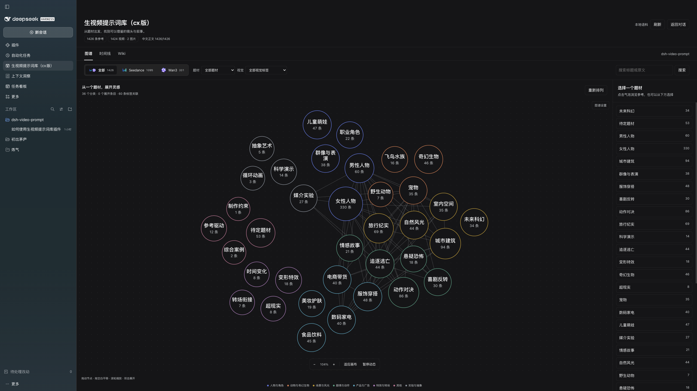
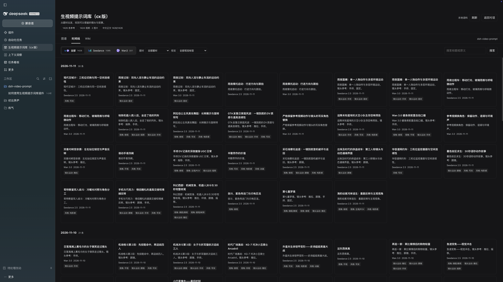
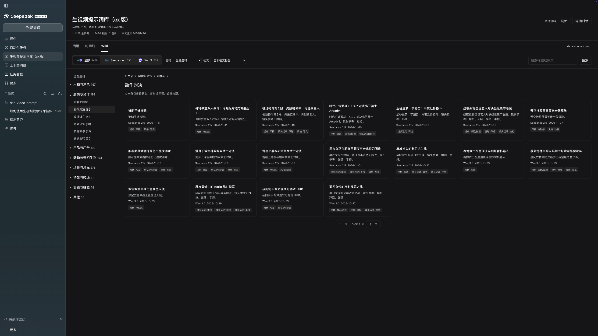

# dsh-生视频提示词库


整理 Seedance 2.5 和 Wan3 的中文视频提示词，用图谱、时间线和 Wiki 找灵感，也可以直接让 AI 按需求查参考。

主要整理 X 上高质量的视频提示词，保留中文正文、来源原文与作者信息。📌 库里的提示词会持续更新。



## 自己逛，也能让 AI 帮你查

在图谱里拖动、缩放、展开分类，顺着不同题材找灵感。按模型、题材和视觉标签筛选，通过时间线和 Wiki 目录查找参考。看到合适的提示词，可以直接复制中文、对照原文、查看来源。





## 把具体需求交给 AI

> 我想用 Seedance 2.5 做一段 30 秒的武侠打斗，帮我找几个参考，看看动作和运镜怎么写，再整理一版中文提示词。

> 做一个自然一点的手机自拍口播，帮我看看库里有哪些好写法，重点参考人物动作和声音。

> 我想做一个一镜到底的产品广告，帮我找找相关案例，看看怎么让镜头动起来，同时保持产品外观一致。

让 AI 带着具体需求找参考，拆一下别人怎么写，再结合自己的想法改。自己逛着找灵感，或者直接让 AI 帮忙查，都可以。

## 安装

在 DeepSeek Harness 的「插件 → 添加插件 → 安装第三方插件」中填入：

```text
https://github.com/mujizi/dsh-video-prompt
```

安装并启用后，打开左侧「生视频提示词库」。已验证 DSH 0.2.2-rc.1。

## 当前发行范围

截图为完整库较早界面的功能演示。公开版当前内置已确认可再分发的 Wan3 语料，Seedance 内容暂未随包发布；实际可检索内容以安装版本为准。[项目说明与许可记录](../README.md#语料与许可)
